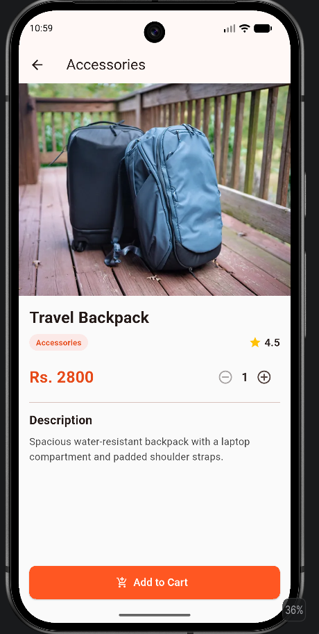

# ShopMandu

** Name: Smaran Aryal
** Mobile Application Development – Flutter

## Description
ShopMandu is a mini e-commerce mobile application built with Flutter. It shows products by category and lets the user move from the home page to a category page and to a product-details page. It uses static/local data only (no backend, login, payment or database).

## Features
- Home page with AppBar (logo, search and cart icons)
- Auto-playing promotional banner carousel (3 banners, tappable)
- Horizontally scrolling category list (6 categories)
- Popular Products section with a "See All" link
- Reusable `ProductCard` (Card, Container, Stack with discount/new badges and favorite icon)
- Category page using `GridView.builder`, filtered by the selected category
- Product details page (image, name, price, rating, category, description)
- Add to Cart button with SnackBar feedback, plus a quantity selector (bonus)
- 13 products, 6 categories, clean reusable-widget structure

## Screenshots
| Home | Category | Product Details |
|------|----------|-----------------|
|  |  |  |

## Packages Used
- [`carousel_slider`](https://pub.dev/packages/carousel_slider) – used to build the auto-playing banner carousel on the home page.

## Project Structure
```
lib/
├── main.dart
├── models/        product.dart, category.dart
├── data/          product_data.dart
├── screens/       home_page.dart, category_page.dart, product_details_page.dart
└── widgets/       product_card.dart, category_item.dart, banner_carousel.dart, safe_network_image.dart
```

## How to Run
```bash
git clone <your-repo-url>
cd shopmandu
flutter pub get
flutter run
```
Internet is required because product and banner images are loaded from network URLs.
